# TÀI LIỆU PHÂN TÍCH YÊU CẦU & THIẾT KẾ HỆ THỐNG (SRS & SDD v2.0)
## DỰ ÁN: CHAONOTE (SOLFA v1.9.4+26) — ỨNG DỤNG LUYỆN CẢM ÂM, KHUÔNG NHẠC, PIANO/GUITAR STUDIO, ĐẤU TRƯỜNG 1v1 & MÁY ĐẾM NHỊP CƠ HỌC

---

### THÔNG TIN QUẢN LÝ TÀI LIỆU
| Thuộc tính | Chi tiết đặc tả |
| --- | --- |
| Tên hệ thống | ChaoNote (Solfa) – Ứng dụng luyện cảm âm, khuông nhạc, Piano/Guitar Studio, Đấu Trường 1v1 & Máy đếm nhịp cơ học |
| Mã gói phát hành (Package ID) | vn.solfa.app.solfa (Google Play Console) |
| Loại tài liệu | Tài liệu Phân tích Yêu cầu & Thiết kế Hệ thống Toàn diện (SRS & SDD – Kèm Trọn bộ 10 Sơ đồ UML 2.5) |
| Phiên bản tài liệu / Ứng dụng | Tài liệu v2.0 • Ứng dụng v1.9.4+26 (Build 26) |
| Nền tảng công nghệ | Flutter 3.x (Dart ^3.5.3) • Riverpod 2.x • GoRouter 14.x • SQLite (sqflite) • Audioplayers 6.x (44.1kHz PCM DSP) |
| Định hướng vận hành | 100% Offline-First • Không yêu cầu đăng ký tài khoản • Bảo mật chữ ký số cục bộ SolfaIntegrityGuard (SHA-256) |
| Phạm vi phân phối quốc tế | 174+ Quốc gia & Vùng lãnh thổ • Tuân thủ Quy định (EU) 2018/302, GDPR, CCPA & Nghị định 13/2023/NĐ-CP |

### LỊCH SỬ THAY ĐỔI TÀI LIỆU (REVISION HISTORY)
| Phiên bản | Ngày cập nhật | Nội dung nâng cấp |
| --- | --- | --- |
| 1.0 | 09/11/2026 | Xây dựng tài liệu phân tích và thiết kế ban đầu (MVP: 3 chủ đề cảm âm cơ bản, Ôn tập câu sai và Máy đếm nhịp). |
| 1.5 | 14/11/2026 | Mở rộng lên 7 chủ đề Cảm âm & Đọc khuông nhạc (Sol/Fa, dòng kẻ phụ), Phòng Piano Studio C3–C5 và Chép nhạc giai điệu. |
| 1.8 | 16/11/2026 | Bổ sung 4 chủ đề Guitar, Guitar Studio (Acoustic & Electric, 44 hợp âm, So dây Hz, 12 bài luyện ngón, Jam Track) và Đấu Trường 1v1. |
| 2.0 | 18/11/2026 | Phát hành v1.9.4+26: Mở rộng 81 câu hỏi Hợp âm Guitar & Piano (Hợp âm chặn, 7th, Sus/Add9, Power Chord, Capo), chống lặp 65% Window, đồng bộ Sáng/Tối, Header & Cài đặt 2 chiều, cân bằng bảng giá Gem (200/300/350/500/800 Gem) và bổ sung trọn bộ 10 sơ đồ UML 2.5. |

---

## MỤC LỤC 19 CHƯƠNG & HỆ THỐNG 10 SƠ ĐỒ UML 2.5
1. **Chương 1**: Tổng quan dự án & Định hướng sản phẩm
2. **Chương 2**: Mục tiêu và phạm vi hệ thống (11 Chủ đề • 2 Studios • Đấu Trường 1v1 • Metronome)
3. **Chương 3**: Đối tượng sử dụng (Actors) và phân tích nhu cầu
4. **Chương 4**: Nguyên tắc thiết kế trải nghiệm & giao diện người dùng (UX/UI Light & Dark Mode)
5. **Chương 5**: Kiến trúc chức năng tổng thể & Sơ đồ Use Case (UML Use Case & Navigation Flow)
6. **Chương 6**: Đặc tả chức năng chi tiết (24 Use Cases cốt lõi)
7. **Chương 7**: Thiết kế luồng nghiệp vụ chính (UML Sequence & Activity Diagrams)
8. **Chương 8**: Quy tắc nghiệp vụ & Công thức tính toán (Business Rules BR-01 đến BR-10)
9. **Chương 9**: Thiết kế dữ liệu Offline-First (UML ERD: 9 bảng SQLite & Kho bảo mật SharedPreferences)
10. **Chương 10**: Kiến trúc kỹ thuật Flutter & Sơ đồ Lớp (UML Component Architecture & Class Diagram)
11. **Chương 11**: Thiết kế hạt nhân âm thanh 44.1kHz PCM DSP & Bộ sinh câu hỏi Hybrid (Anti-Repeat 65%)
12. **Chương 12**: Thiết kế Máy đếm nhịp cơ học độ trễ thấp (<10ms) & Sơ đồ Máy trạng thái (UML State Machine)
13. **Chương 13**: Hệ sinh thái Kinh tế Gem, Quảng cáo có thưởng & Bảo mật chống gian lận (`SolfaIntegrityGuard`)
14. **Chương 14**: Yêu cầu phi chức năng, Đa ngôn ngữ & Tuân thủ pháp lý quốc tế (EU 2018/302, GDPR, Nghị định 13)
15. **Chương 15**: Xử lý lỗi, Quản lý vòng đời ứng dụng (Lifecycle) và Tình huống ngoại lệ
16. **Chương 16**: Kiểm thử tự động (23 Kịch bản Nghiệm thu TC-01 -> TC-23)
17. **Chương 17**: Lộ trình phát triển sản phẩm (Roadmap v1.0 -> v2.0+)
18. **Chương 18**: Quản trị rủi ro kỹ thuật và Giải pháp giảm thiểu
19. **Chương 19**: Kết luận

---

## 1. TỔNG QUAN DỰ ÁN
### 1.1. Giới thiệu hệ thống
**ChaoNote (Solfa)** là ứng dụng di động đa nền tảng (Android & iOS) phát triển bằng **Flutter**, giúp người học rèn luyện khả năng **cảm âm (Ear Training)**, **thị tấu đọc bản nhạc trên khuông Khóa Sol/Fa & Tab Guitar**, thực hành trực tiếp trên **Đàn Piano Studio (C3–C5)** và **Đàn Guitar Studio (Acoustic & Electric)**, tranh tài phản xạ tại **Đấu Trường Âm Nhạc 1v1**, đồng thời giữ nhịp luyện đàn với **Máy đếm nhịp cơ học (Mechanical Metronome)** độ trễ dưới `10ms`.

Toàn bộ hệ thống vận hành theo kiến trúc **100% Offline-First**: không bắt buộc đăng ký tài khoản, không thu thập dữ liệu cá nhân, lưu trữ bền vững trên cơ sở dữ liệu cục bộ **SQLite** kết hợp cơ chế bảo vệ chống gian lận chữ ký số **SHA-256 (`SolfaIntegrityGuard`)**.

### 1.2. Định hướng cốt lõi
* **Đơn giản & Trực quan**: Mở ứng dụng là có thể bắt đầu luyện tập ngay chỉ với 1 chạm từ thẻ Hero *"Tiếp tục bài học"*.
* **Học qua Nghe & Chạm Nhạc Cụ**: Kết hợp 283+ mẫu âm thanh tổng hợp DSP 44.1kHz PCM WAV với bàn phím Piano 25 phím và cần đàn Guitar 6 dây tương tác trực tiếp.
* **Không cắt chữ & Đồng nhất Sáng/Tối**: Hệ thống Header tinh gọn (`[💎 Số dư]`, `[🔥 Chuỗi ngày]`, `[⚙️]`), hộp thoại xác nhận nút ngang đối xứng và độ tương phản chuẩn WCAG trên cả hai chế độ Light Mode và Dark Mode.
* **Kiếm tiền văn minh (Voluntary Rewarded Economy)**: Tuyệt đối không chèn quảng cáo tự động làm gián đoạn bài học; người dùng chủ động làm nhiệm vụ ngày hoặc xem video ngắn 15 giây để tích lũy **Gem** mở khóa phiên chuyên sâu.

---

## 2. MỤC TIÊU VÀ PHẠM VI HỆ THỐNG (11 CHỦ ĐỀ & 35 CẤP ĐỘ)
| Chủ đề (Topic ID) | Phân nhóm | Số cấp độ | Nội dung học thuật & Tương tác |
| --- | --- | --- | --- |
| 1. Nhận biết nốt (topic_notes) | Cảm âm Piano | 4 Cấp (Mức 1..4) | Nghe cao độ nốt đơn từ C3–C5 (Tự nhiên & Thăng/Giáng #/b), trả lời trắc nghiệm hoặc bấm trực tiếp phím Piano. |
| 2. Đọc nốt nhạc (topic_staff_reading) | Thị tấu Khuông nhạc | 4 Cấp (Mức 1..4) | Đọc nốt trên Khuông 5 dòng kẻ Khóa Sol & Khóa Fa (C3–C6), bao gồm chế độ Chuyên luyện Dòng kẻ phụ. |
| 3. Nhận biết quãng (topic_intervals) | Cảm âm Hòa thanh | 3 Cấp (Cơ bản..Nâng cao) | Phân biệt quãng 2, 3, 4, 5, 6, 7, 8 và quãng 4 tăng/5 giảm (Giai điệu đi lên/xuống & Hòa thanh). |
| 4. Nhận biết hợp âm Piano (topic_chords) | Hòa âm Piano | 3 Cấp (32 câu hỏi) | Nhận diện Hợp âm Trưởng, Thứ, Giảm (dim), Tăng (aug), Maj7, m7, Dom7, Sus2, Sus4, Add9 trên Piano. |
| 5. Giai điệu ngắn (topic_melody) | Trí nhớ Âm nhạc | 3 Cấp (Cơ bản..Nâng cao) | Nghe và xác định chuỗi 3–4 nốt giai điệu đi lên, đi xuống, ngũ cung và bước nhảy quãng rộng. |
| 6. Nhịp điệu & Tiết tấu (topic_rhythm) | Tiết tấu | 3 Cấp (Cơ bản..Nâng cao) | Nhận diện hình nốt Trắng, Đen, Móc đơn, Liên 3 (Triplet), Móc kép, Đảo phách (Syncopation) & nhịp 2/4, 3/4, 6/8. |
| 7. Nhận biết giọng (topic_keys) | Cảm âm Điệu tính | 3 Cấp (Cơ bản..Nâng cao) | Nghe chuỗi hòa âm I–IV–V–I phân biệt Giọng Trưởng, Giọng Thứ tự nhiên, Thứ hòa thanh & Thứ giai điệu. |
| 8. Nốt trên cần đàn Guitar (topic_guitar_notes) | Nhạc cụ Guitar | 3 Cấp (Cơ bản..Nâng cao) | Xác định vị trí nốt trên 6 dây đàn Guitar (E2–A2–D3–G3–B3–E4) từ ngăn buông đến ngăn 12. |
| 9. Hợp âm Guitar (topic_guitar_chords) | Hòa âm Guitar | 3 Cấp (49 câu hỏi) | Nhận diện thế bấm & âm thanh Hợp âm mở, 8 Hợp âm chặn (F, Fm, Bm, B, F#m, Gm, Cm, Bb), Hợp âm 7, Màu sắc, Power Chord 5 & Capo. |
| 10. Âm giai Guitar (topic_guitar_scales) | Kỹ thuật Lead/Solo | 3 Cấp (Cơ bản..Nâng cao) | Bản đồ âm giai Đô Trưởng, La Thứ, Ngũ cung (Pentatonic), Blues và La Thứ Hài Hòa trên cần đàn. |
| 11. Đọc Tab & Riff Guitar (topic_guitar_tabs) | Thị tấu Tab 6 dây | 3 Cấp (Cơ bản..Nâng cao) | Đọc bản nhạc Tablature 6 dây, ký hiệu Hammer-on, Pull-off, Slide và các câu Riff kinh điển. |

---

## 3. ĐỐI TƯỢNG SỬ DỤNG (ACTORS) VÀ NHU CẦU
1. **Người học nhạc (`Primary Actor`)**: Học sinh, sinh viên nhạc viện, người tự học Piano/Guitar và người luyện thanh cần công cụ rèn tai nghe, nhớ vị trí nốt trên khuông nhạc/cần đàn và giữ nhịp hàng ngày.
2. **Người chơi thứ 2 (`Local Split-Screen Actor`)**: Bạn bè cùng thi đấu phản xạ cảm âm trực tiếp trên cùng 1 thiết bị ở chế độ *Đấu 2 Người 1 Máy*.
3. **Hạt nhân Âm thanh DSP & SQLite (`Local Engine Actor`)**: Thực thi truy vấn dữ liệu ngoại tuyến và phát âm thanh đa âm (Polyphonic Pool) độ trễ cực thấp.
4. **Hệ thống Quảng cáo Có thưởng & Bảo mật (`Rewarded Ad & SolfaIntegrityGuard`)**: Cung cấp video nhận thưởng 15 giây và kiểm định chữ ký số SHA-256 cùng đồng hồ đơn điệu chống chỉnh lùi giờ.

---

## 4. NGUYÊN TẮC TRẢI NGHIỆM & GIAO DIỆN NGƯỜI DÙNG (UX/UI)
* **Header chính 4 Tab (`MainShell`)**: Chỉ hiển thị biểu tượng Logo tại Tab *Trang chủ (`ChaoNote`)*; ở 3 tab *Phòng luyện tập*, *Máy đếm nhịp* và *Tiến trình* ẩn Logo lặp lại để nhường 100% chiều ngang cho tiêu đề trang. Cụm huy hiệu bên phải chỉ hiển thị Icon + Số (`[💎 220]`, `[🔥 6]`, `[⚙️]`) bọc trong `FittedBox` chống cắt chữ `...` trên mọi kích thước màn hình (kể cả màn hình nhỏ `360x680`).
* **Header Đấu Trường 1v1 (`BattleScreen`)**: Hiển thị gọn `[←] [⚔️] Đấu Trường 1v1` và duy nhất 1 huy hiệu năng lượng `[⚡ 5/5]` bên phải (không lặp lại huy hiệu Sao đã có ở thẻ Hạng ngay bên dưới).
* **Hộp thoại xác nhận nút ngang đối xứng**: Toàn bộ các popup xác nhận (*Kết thúc phiên luyện tập*, *Xóa dữ liệu lịch sử*, *Đặt lại mẫu nhịp*) sử dụng bố cục `Row` + `Expanded` cân đối 2 nút trái/phải thay vì xếp chồng dọc.
* **Đồng bộ tương phản Sáng / Tối (`AppTheme`)**: Đặt `outlinedButtonTheme.backgroundColor = Colors.transparent` làm gốc và phủ nền kính mờ (`Colors.white.withOpacity(0.14)`) trên các thẻ Hero tối màu để không bao giờ xảy ra lỗi chữ trắng trên nền trắng.

---

## 5. KIẾN TRÚC CHỨC NĂNG TỔNG THỂ & SƠ ĐỒ USE CASE (UML)

### 5.1. Hình 1 — Sơ đồ Use Case Tổng Quát & Phân Rã Hệ Thống
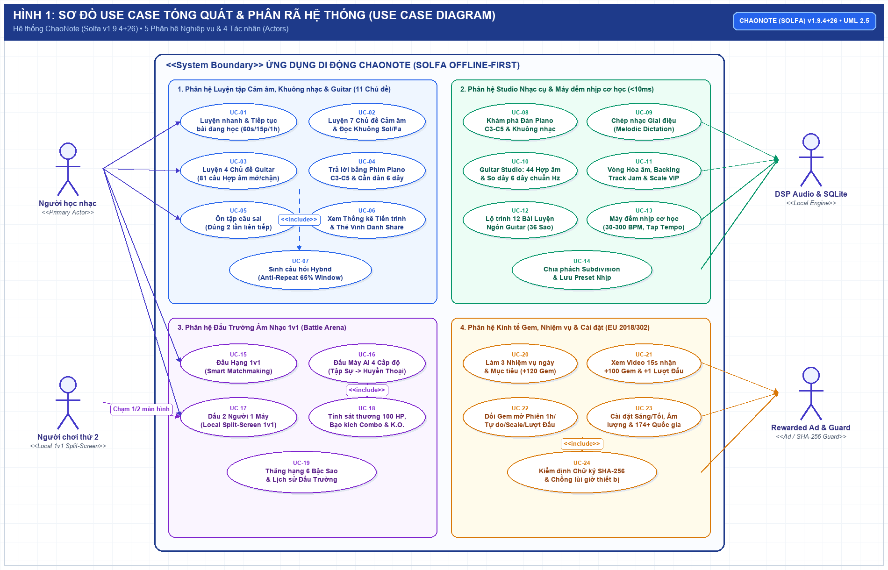

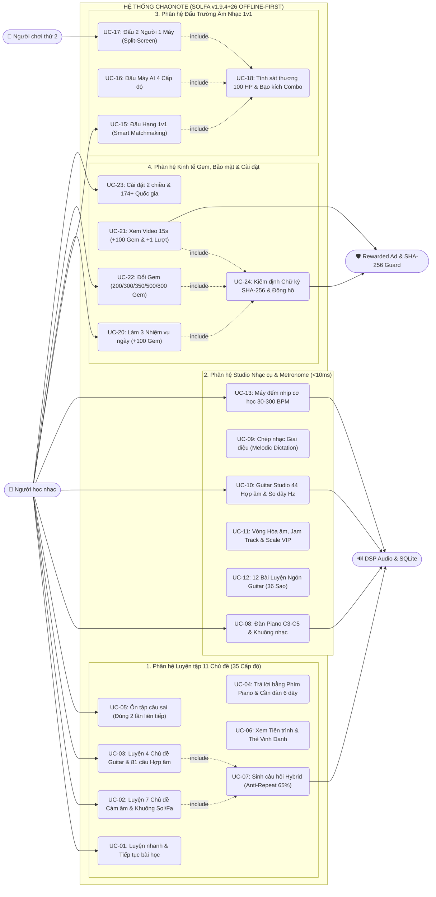

### 5.2. Hình 3 — Sơ đồ Luồng Điều Hướng Màn Hình (`GoRouter UI Navigation Flow`)
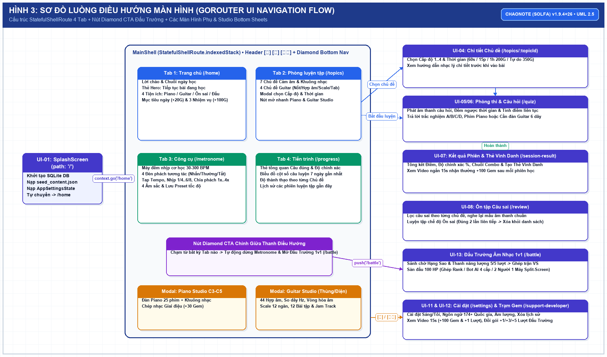

---

## 6. ĐẶC TẢ CHỨC NĂNG CHI TIẾT
* **Phân hệ Trang chủ (`/home`)**: Hiển thị chuỗi ngày học (Streak), thẻ Hero *Tiếp tục bài học*, thanh 4 tiện ích nhanh (*Đàn Piano*, *Đàn Guitar*, *Ôn câu sai*, *Đấu trường*), thanh tiến độ *Mục tiêu hôm nay (`+20 Gem`)* và danh sách *3 Nhiệm vụ hàng ngày (`+100 Gem`)*.
* **Phân hệ Phòng luyện tập & Phòng thi (`/topics`, `/quiz`, `/session-result`)**: Hỗ trợ 4 chế độ thời gian: **60 giây (Miễn phí)**, **15 phút (Miễn phí)**, **1 tiếng (`200 Gem`)** và **Tự do không giới hạn (`350 Gem`)**. Hỗ trợ trả lời bằng 4 thẻ A/B/C/D, bàn phím Piano C3–C5 hoặc sơ đồ cần đàn Guitar 6 dây có huy hiệu `"Chặn 1"` cho hợp âm chặn (Barre chords).
* **Phân hệ Studio Nhạc cụ (`FreePianoExplorerSheet` & `GuitarStudioSheet`)**:
  * **Piano Studio**: Đàn tự do 25 phím (C3–C5) hiển thị vị trí nốt trên khuông Khóa Sol và chế độ *Chép nhạc giai điệu*.
  * **Guitar Studio**: Chuyển đổi âm sắc *Guitar Thùng (Acoustic)* & *Guitar Điện (Electric Overdrive)*, thư viện 44 hợp âm, bộ so dây 6 dây chuẩn tần số Hz có chế độ lặp (Loop Tuner), máy chạy vòng hòa âm tự động, phòng Jam Backing Track, bản đồ Scale 12 ngăn (mở khóa VIP bằng `300 Gem`) và lộ trình 12 bài luyện ngón chấm 36 Sao.
* **Phân hệ Đấu Trường Âm Nhạc 1v1 (`/battle`)**: Truy cập nhanh từ nút Diamond CTA ở chính giữa thanh điều hướng dưới. Hỗ trợ *Đấu Hạng 1v1*, *Đấu Máy AI (Tập Sự, Nhạc Công, Cao Thủ, Huyền Thoại)* và *2 Người 1 Máy (Chia đôi màn hình đối xứng)*.

---

## 7. LUỒNG NGHIỆP VỤ CHÍNH (UML SEQUENCE & ACTIVITY DIAGRAMS)

### 7.1. Hình 6 — Sơ đồ Tuần Tự Luồng Phiên Luyện Tập & Bộ Sinh Câu Hỏi Hybrid
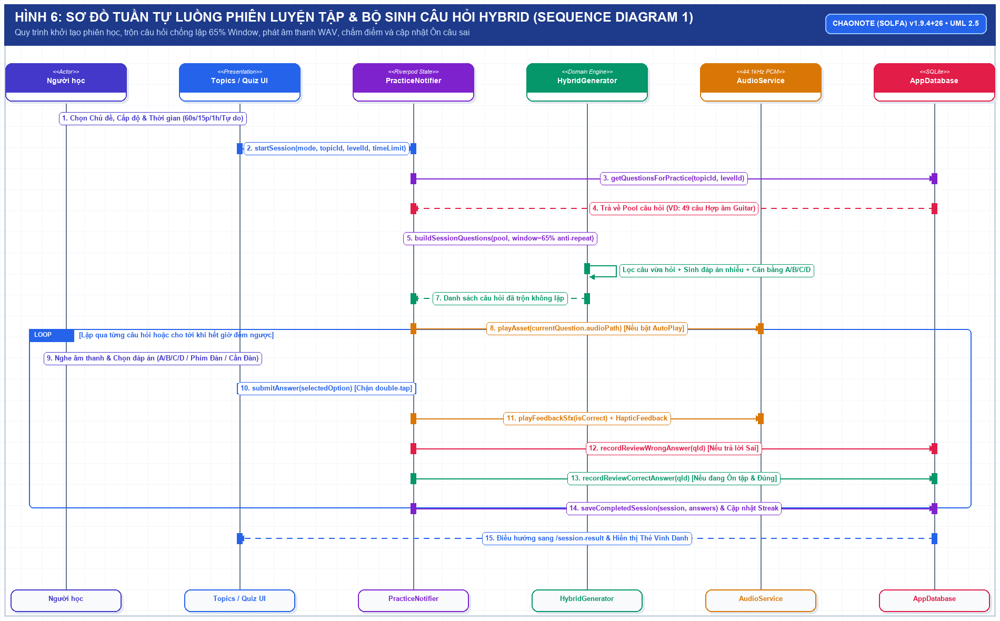

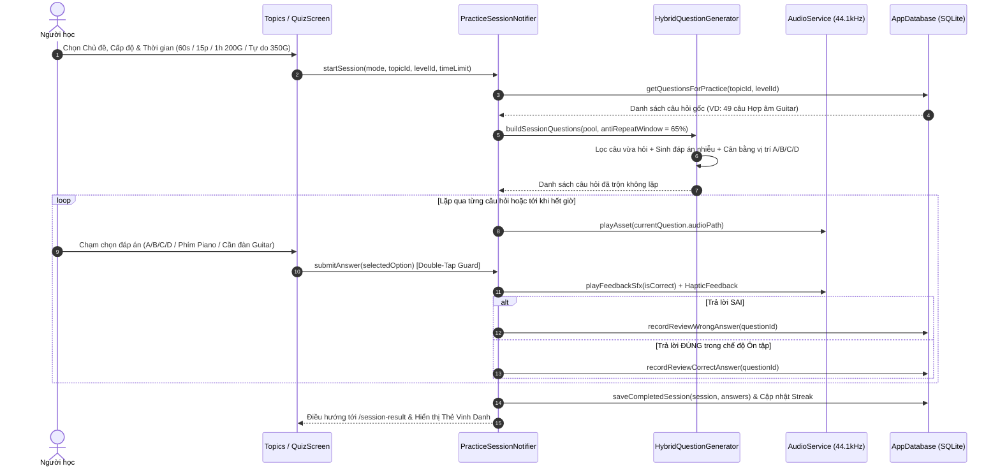

### 7.2. Hình 7 — Sơ đồ Tuần Tự Đấu Trường Âm Nhạc 1v1
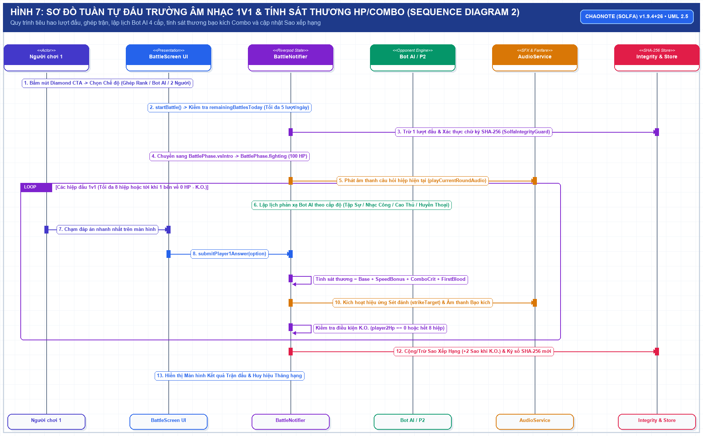

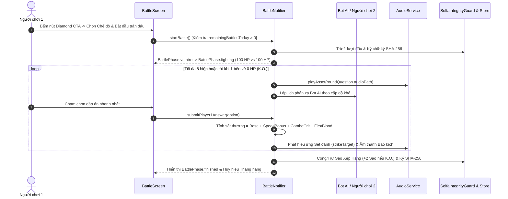

### 7.3. Hình 8 — Sơ đồ Tuần Tự Kinh Tế Gem, Quảng Cáo Có Thưởng & Bảo Mật SHA-256
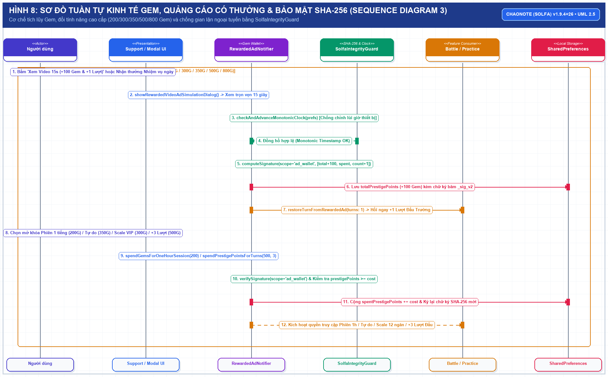

### 7.4. Hình 9 — Sơ đồ Hoạt Động Nghiệp Vụ Ôn Tập Câu Sai & Phòng Studio Nhạc Cụ
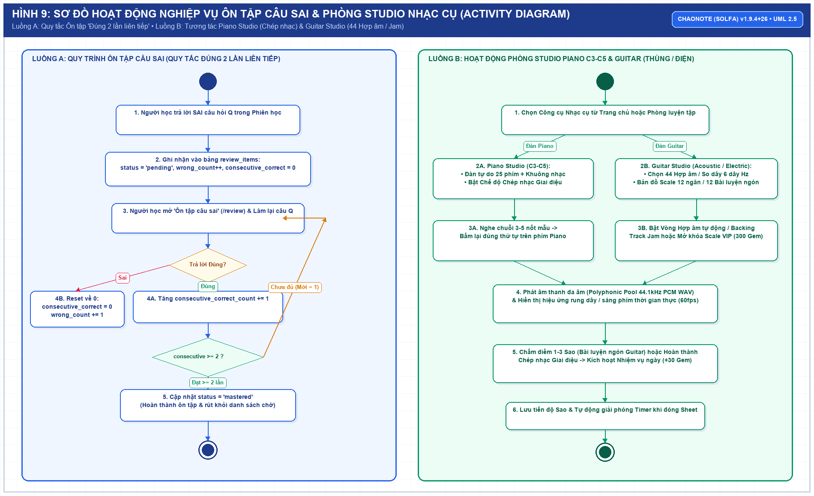

---

## 8. QUY TẮC NGHIỆP VỤ (BUSINESS RULES BR-01 ĐẾN BR-10)
| Mã quy tắc | Tên quy tắc nghiệp vụ | Mô tả đặc tả kỹ thuật |
| --- | --- | --- |
| BR-01 | Hoạt động 100% Offline-First | Toàn bộ 11 chủ đề, 283+ mẫu âm thanh WAV, Piano/Guitar Studio, Đấu Trường 1v1 và Máy đếm nhịp hoạt động ngoại tuyến không cần Internet. |
| BR-02 | Chống lặp câu hỏi Cửa sổ trượt 65% | HybridQuestionGenerator lưu danh sách câu vừa xuất hiện với kích thước cửa sổ bằng 65% tổng số câu của cấp độ để ngăn lặp lại nhàm chán. |
| BR-03 | Cân bằng xác suất đáp án A/B/C/D | Tự động đảo vị trí đáp án đúng và lấy mẫu ngẫu nhiên đáp án nhiễu (Dynamic Distractors) sao cho không vị trí nào vượt quá 2 lần liên tiếp. |
| BR-04 | Chống bấm trùng (Double-Tap Guard) | Khi người dùng đã chọn đáp án, khóa cờ isSubmittingAnswer ngay lập tức để ngăn cộng điểm kép hoặc ghi bản ghi trùng. |
| BR-05 | Quy tắc Ôn tập 'Đúng 2 lần liên tiếp' | Câu trả lời sai được đưa vào review_items (status='pending'). Chỉ khi trả lời đúng 2 lần liên tiếp (consecutive_correct_count >= 2) mới chuyển sang 'mastered'. |
| BR-06 | Đồng bộ Cài đặt 2 chiều bền vững | Mọi thay đổi về Thời gian luyện tập mặc định (60s/15p/1h/Tự do), Âm sắc Metronome, Giao diện Sáng/Tối và Ngôn ngữ được đồng bộ tức thì và lưu vào SQLite. |
| BR-07 | Giới hạn 5 Lượt Đấu Trường miễn phí/ngày | Mỗi ngày cấp mới 5 lượt Đấu Trường miễn phí. Khi hết lượt, người chơi có thể xem video 15s (+1 lượt & +100 Gem) hoặc đổi 200/500/800 Gem. |
| BR-08 | Công thức Sát thương & Bạo kích 1v1 | Mỗi đấu thủ có 100 HP. Trả lời đúng gây sát thương = Base (18) + SpeedBonus (0..8) + ComboCrit (+6..14) + FirstBlood (+4). Trả lời sai tự mất 12 HP và khóa chọn hiệp đó. |
| BR-09 | Bảo mật Chữ ký số & Chống lùi giờ | SolfaIntegrityGuard ký SHA-256 Salted cho Ví Gem, Sao Đấu Trường và Nhiệm vụ ngày; Monotonic Clock Guard từ chối nhận thưởng nếu phát hiện chỉnh lùi đồng hồ thiết bị. |
| BR-10 | Quản lý Vòng đời Âm thanh & Nền | Khi người dùng ẩn ứng dụng xuống nền (AppLifecycleState.paused) hoặc rời tab Công cụ, tự động dừng Metronome, Vòng hợp âm, Jam Track và giải phóng Timer. |

---

## 9. THIẾT KẾ DỮ LIỆU OFFLINE-FIRST (UML ERD)

### 9.1. Hình 5 — Sơ đồ Thực Thể Liên Kết Cơ Sở Dữ Liệu Cục Bộ (`SQLite ERD & Secure Store`)
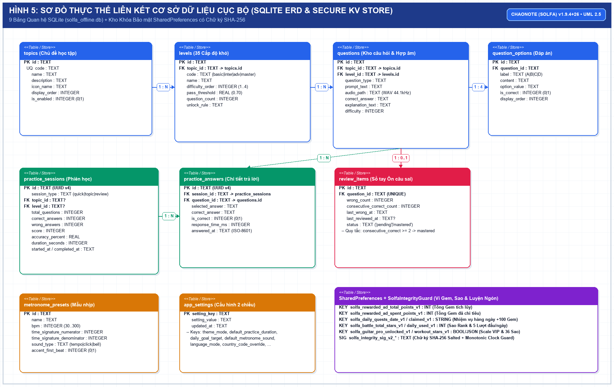

```mermaid
erDiagram
    topics ||--o{ levels : "has 3..4 levels"
    topics ||--o{ questions : "contains"
    levels ||--o{ questions : "categorizes"
    questions ||--|{ question_options : "has 4 options"
    practice_sessions ||--|{ practice_answers : "records"
    questions ||--o{ practice_answers : "answered in"
    questions ||--o| review_items : "tracked in"

    topics {
        TEXT id PK
        TEXT code UQ
        TEXT name
        INTEGER display_order
        INTEGER is_enabled
    }
    levels {
        TEXT id PK
        TEXT topic_id FK
        TEXT code
        INTEGER difficulty_order
        REAL pass_threshold
        INTEGER question_count
    }
    questions {
        TEXT id PK
        TEXT topic_id FK
        TEXT level_id FK
        TEXT question_type
        TEXT prompt_text
        TEXT audio_path
        TEXT correct_answer
        TEXT explanation_text
    }
    question_options {
        TEXT id PK
        TEXT question_id FK
        TEXT label
        TEXT content
        TEXT option_value
        INTEGER is_correct
    }
    practice_sessions {
        TEXT id PK
        TEXT session_type
        TEXT topic_id FK
        TEXT level_id FK
        INTEGER total_questions
        INTEGER correct_answers
        INTEGER score
        REAL accuracy_percent
        INTEGER duration_seconds
    }
    review_items {
        TEXT id PK
        TEXT question_id FK
        INTEGER wrong_count
        INTEGER consecutive_correct_count
        TEXT status
    }
    app_settings {
        TEXT setting_key PK
        TEXT setting_value
        TEXT updated_at
    }
```

---

## 10. KIẾN TRÚC KỸ THUẬT FLUTTER & SƠ ĐỒ LỚP (UML ARCHITECTURE & CLASS DIAGRAM)

### 10.1. Hình 2 — Kiến Trúc Phân Tầng & Thành Phần Hệ Thống (`Layered & Component Architecture`)
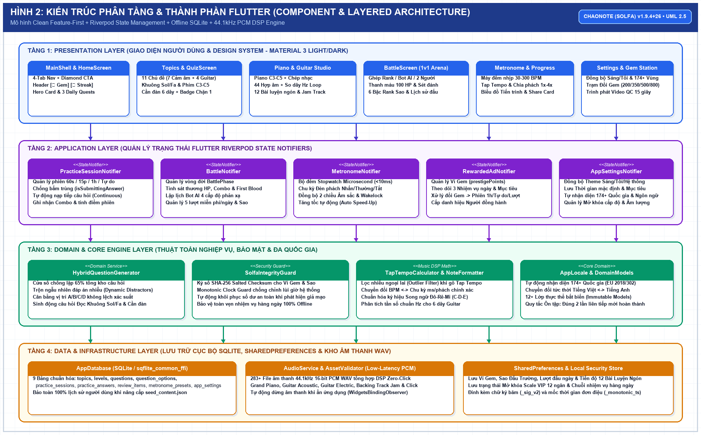

### 10.2. Hình 4 — Sơ đồ Lớp Chi Tiết (`UML Class Diagram`)
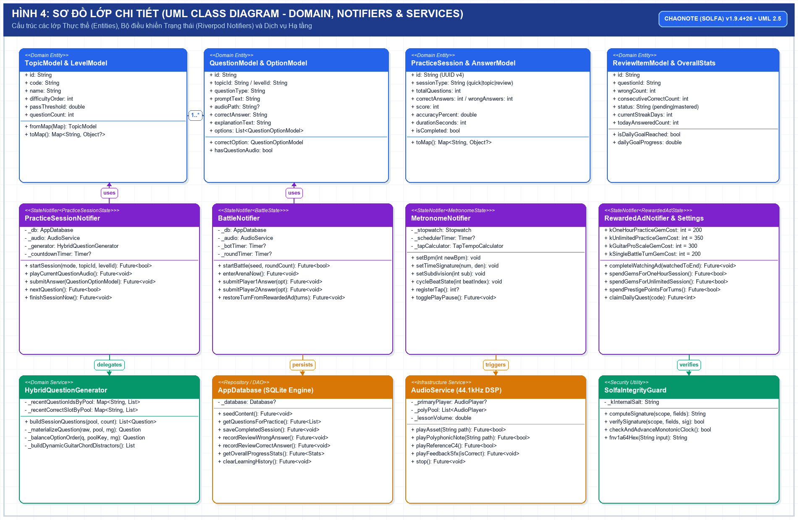

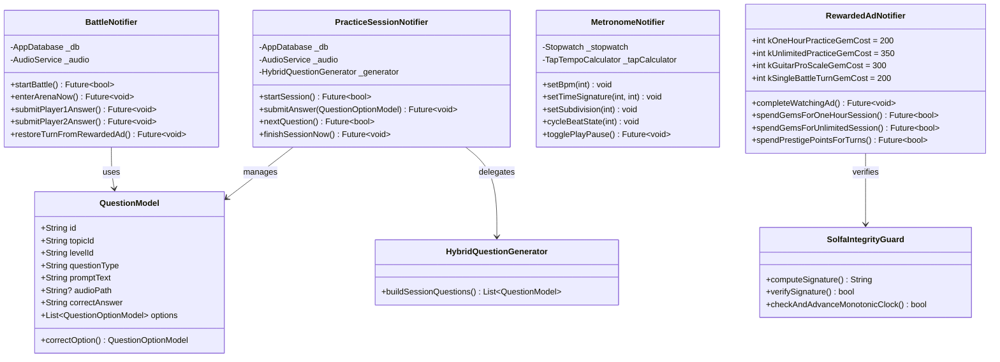

---

## 11. THIẾT KẾ HẠT NHÂN ÂM THANH 44.1kHz PCM DSP & BỘ SINH CÂU HỎI HYBRID
* **Tổng hợp âm thanh DSP Zero-Click (`tool/generate_audio_assets.py`)**: Toàn bộ 283+ tệp âm thanh `.wav` (Grand Piano, Guitar Acoustic Karplus-Strong, Guitar Electric Overdrive, Vòng hòa âm, Backing Track Jam và tiếng gõ Metronome) được tổng hợp ở tần số lấy mẫu `44.100 Hz`, `16-bit Mono PCM`, áp dụng đường bao biên độ (ADSR Envelope) và fade-out `15ms` cuối mẫu để triệt tiêu hoàn toàn tiếng nổ bốp (Zero-Click).
* **Thuật toán Sinh câu hỏi Hybrid (`HybridQuestionGenerator`)**:
  * Duy trì bộ nhớ đệm `_recentQuestionIdsByPool` với kích thước cửa sổ trượt bằng **65% tổng số câu hỏi của cấp độ** (`(pool.length * 0.65).round()`), đảm bảo người học làm liên tiếp hàng chục câu không gặp lại câu vừa xuất hiện.
  * Tự động lấy mẫu ngẫu nhiên 3 đáp án nhiễu (Dynamic Distractors) từ cùng nhóm hợp âm/cần đàn và đảo vị trí A/B/C/D cân bằng.

---

## 12. THIẾT KẾ MÁY ĐẾM NHỊP CƠ HỌC (<10ms) & SƠ ĐỒ MÁY TRẠNG THÁI (UML STATE MACHINE)

### 12.1. Hình 10 — Sơ đồ Máy Trạng Thái Đấu Trường 1v1 & Máy Đếm Nhịp Cơ Học
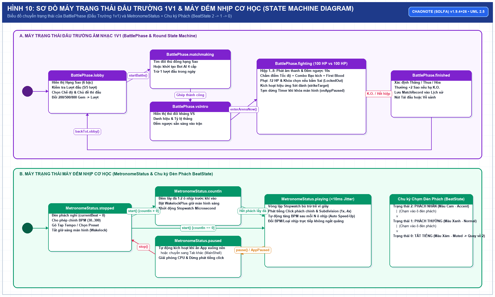

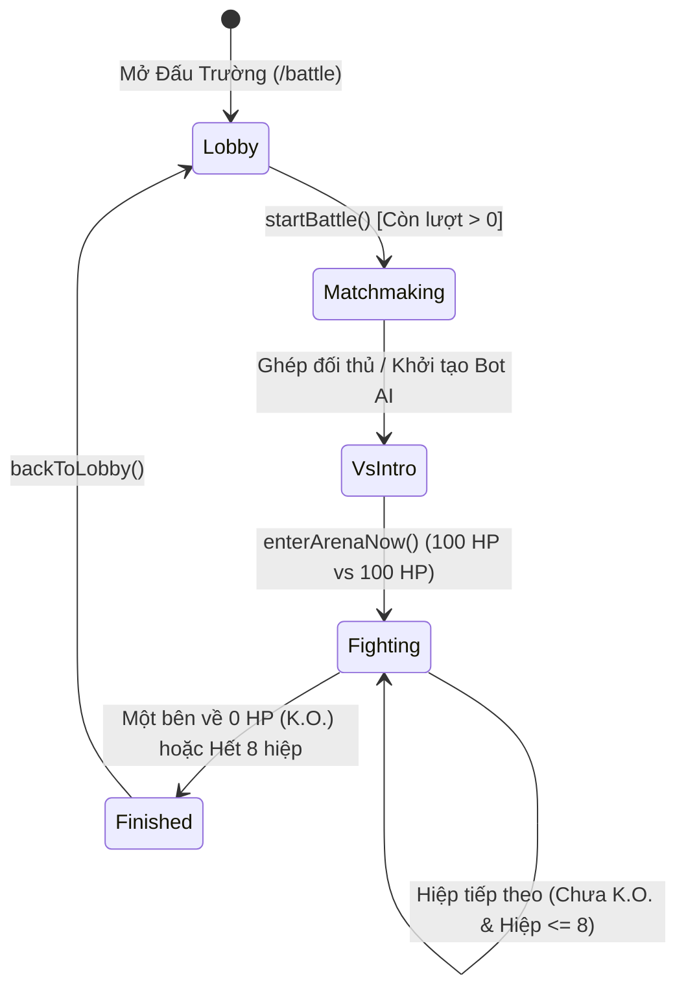

---

## 13. HỆ SINH THÁI KINH TẾ GEM, QUẢNG CÁO CÓ THƯỞNG & BẢO MẬT (`SolfaIntegrityGuard`)
| Hoạt động / Tính năng | Loại giao dịch | Định mức Gem | Cơ chế vận hành & Bảo mật |
| --- | --- | --- | --- |
| Xem Video Quảng cáo ngắn tự nguyện (15 giây) | Tích lũy (+) | +100 Gem & +1 Lượt Đấu | Không ép buộc; người dùng chủ động mở tại Trạm Đổi Gem, Đấu Trường hoặc sau phiên học. |
| Hoàn thành Mục tiêu học tập hàng ngày (10..50 câu) | Tích lũy (+) | +20 Gem / ngày | Chống nhận trùng trong cùng 1 ngày bằng khóa ngày ISO & chữ ký SHA-256. |
| Nhiệm vụ ngày 1: Luyện cảm âm 10 câu | Tích lũy (+) | +30 Gem / ngày | Tự động mở khóa nút Nhận khi todayAnsweredCount >= 10. |
| Nhiệm vụ ngày 2: Đấu 1 trận Đấu Trường 1v1 | Tích lũy (+) | +40 Gem / ngày | Hoàn thành 1 trận ở bất kỳ chế độ Đấu Trường nào. |
| Nhiệm vụ ngày 3: Chép nhạc 1 giai điệu Piano | Tích lũy (+) | +30 Gem / ngày | Hoàn thành 1 bài Chép nhạc giai điệu trong Piano Studio C3–C5. |
| Mở khóa Phiên luyện tập chuyên sâu 1 tiếng (3600s) | Chi tiêu (-) | 200 Gem (kOneHourPracticeGemCost) | Tương đương ~2 lượt xem video quảng cáo hoặc hoàn thành nhiệm vụ. |
| Mở khóa Chế độ Tự do không giới hạn thời gian | Chi tiêu (-) | 350 Gem (kUnlimitedPracticeGemCost) | Tương đương ~3.5 lượt xem video quảng cáo; luyện tập liên tục không đếm ngược. |
| Mở khóa vĩnh viễn Full Map Scale VIP 12 ngăn Guitar | Chi tiêu (-) | 300 Gem (kGuitarProScaleGemCost) | Mở khóa vĩnh viễn âm giai La Thứ Hài Hòa & toàn bộ 12 ngăn cần đàn. |
| Đổi Gói +1 Lượt Đấu Trường 1v1 | Chi tiêu (-) | 200 Gem (kSingleBattleTurnGemCost) | Hồi ngay +1 lượt thi đấu Đấu Trường khi hết 5 lượt miễn phí/ngày. |
| Đổi Gói +3 Lượt Đấu Trường 1v1 (Tiết kiệm 100 Gem) | Chi tiêu (-) | 500 Gem (kThreeBattleTurnsGemCost) | Hồi ngay +3 lượt thi đấu Đấu Trường (ưu đãi tiết kiệm 100 Gem). |
| Đổi Gói +5 Lượt Đấu Trường 1v1 (Tiết kiệm 200 Gem) | Chi tiêu (-) | 800 Gem (kFiveBattleTurnsGemCost) | Hồi đầy thanh +5 lượt thi đấu Đấu Trường (ưu đãi tiết kiệm 200 Gem). |

---

## 14. YÊU CẦU PHI CHỨC NĂNG & TUÂN THỦ PHÁP LÝ QUỐC TẾ (EU 2018/302 & GDPR)
* **Hiệu năng 60fps**: Bọc các thành phần đồ họa phức tạp (Khuông nhạc `StaffQuestionWidget`, Bàn phím Piano `PianoKeyboardAnswerWidget`, Cần đàn Guitar `GuitarQuestionBoardWidget`, Máy đếm nhịp) trong `RepaintBoundary` để cô lập vùng vẽ lại.
* **Tuân thủ Quy định (EU) 2018/302 (Chống chặn địa lý - Geo-blocking Regulation)**: Cung cấp quyền truy cập bình đẳng tại 27 quốc gia EU/EEA và hơn 174 quốc gia trên Google Play; tự động nhận diện vùng và chuyển đổi ngôn ngữ *Tiếng Việt / Tiếng Anh Quốc tế* hoàn toàn ngoại tuyến qua `PlatformDispatcher.instance.locale` mà không cần GPS.

---

## 15. XỬ LÝ LỖI, VÒNG ĐỜI ỨNG DỤNG (LIFECYCLE) & TÌNH HUỐNG NGOẠI LỆ
* **Quản lý vòng đời (`WidgetsBindingObserver`)**: Các màn hình có bộ đếm nhịp hoặc vòng lặp âm thanh (`MetronomeScreen`, `GuitarStudioSheet`, `BattleScreen`, `QuizScreen`) tự động tạm dừng âm thanh và hủy `Timer` ngay khi ứng dụng chuyển sang trạng thái `AppLifecycleState.paused` hoặc `detached`.
* **Chống lỗi mất tệp âm thanh (`AssetValidator`)**: Tự động kiểm tra sự tồn tại của tệp `.wav` trước khi phát; nếu thiết bị tắt tiếng hoặc lỗi phần cứng âm thanh, câu hỏi vẫn hiển thị đầy đủ gợi ý trực quan để người dùng không bị kẹt phiên học.

---

## 16. KIỂM THỬ TỰ ĐỘNG & TIÊU CHÍ NGHIỆM THU (23 TEST CASES TC-01 -> TC-23)
| Mã Kịch bản | Tên Kịch bản Kiểm thử | Nội dung & Tiêu chí Nghiệm thu | Kết quả |
| --- | --- | --- | --- |
| TC-01 | Khởi động Offline lần đầu | Mở ứng dụng khi không có mạng -> Tự động seed SQLite, hiển thị Trang chủ bình thường. | PASSED |
| TC-02..05 | Luồng làm bài & Lưu lịch sử | Chọn đáp án đúng/sai, phát phản hồi âm thanh, hoàn thành phiên và lưu vào practice_sessions. | PASSED |
| TC-06 | Quy tắc Ôn tập câu sai (2 lần) | Trả lời sai -> vào danh sách ôn; đúng lần 1 vẫn pending; đúng lần 2 liên tiếp -> mastered. | PASSED |
| TC-07 | Đồng bộ Giao diện Sáng / Tối | Chuyển đổi Light / Dark / System -> Tương phản nút bấm đồng nhất, lưu bền vững vào SQLite. | PASSED |
| TC-08..11 | Máy đếm nhịp cơ học & Tap Tempo | Kiểm định chu kỳ 60 BPM (1.0s), 120 BPM (0.5s), lọc nhiễu Tap Tempo và đổi nhịp 1/4..6/8. | PASSED |
| TC-12 | Xem quảng cáo khi Offline | Bấm xem video khi mất mạng -> Hiển thị hộp thoại thông báo thân thiện, không văng ứng dụng. | PASSED |
| TC-13 | Chống bấm trùng (Double-Tap) | Chạm liên tiếp vào đáp án trong cùng 1 câu -> Chỉ ghi nhận 1 lần chấm điểm duy nhất. | PASSED |
| TC-14 | Bảo toàn dữ liệu khi nâng cấp | Chạy lại seedContent() khi nâng cấp phiên bản -> Giữ nguyên 100% lịch sử học và chuỗi ngày. | PASSED |
| TC-15 | 4 Chế độ Thời gian luyện tập | Kiểm định đếm ngược 60 giây, 15 phút, 1 tiếng (200 Gem) và Tự do không giới hạn (350 Gem). | PASSED |
| TC-16 | 4 Mức độ Nhận biết nốt & Piano | Trả lời bằng bàn phím Piano C3–C5 và kiểm định đèn phách Nhấn/Thường/Tắt của Metronome. | PASSED |
| TC-17 | Độ ổn định UI màn hình nhỏ | Render toàn bộ màn hình trên kích thước 360x680 ở cả Light/Dark Mode -> Không lỗi tràn khung hay cắt chữ (...). | PASSED |
| TC-18 | Xử lý tình huống biên (Edge Cases) | Đổi chế độ giữa phiên, danh sách ôn tập rỗng, giới hạn BPM 30..300 -> Không phát sinh ngoại lệ. | PASSED |
| TC-19 | Chủ đề Hợp âm, Giai điệu, Nhịp | Kiểm định mở khóa chủ đề mới, tính Combo liên tiếp, kỷ lục điểm cao và Mục tiêu hàng ngày. | PASSED |
| TC-20 | Thuật toán Random Hybrid (65%) | Kiểm định phân phối đồng đều, không lặp câu hỏi liên tiếp, đảo A/B/C/D và nạp tiếp câu hỏi ở mốc câu 20. | PASSED |
| TC-21 | Đấu Trường Âm Nhạc 1v1 & Đổi Gem | Ghép trận, Bot AI 4 cấp, Đấu 2 người 1 máy, tính sát thương HP/Combo, giới hạn 5 lượt/ngày & đổi gói 200/500 Gem. | PASSED |
| TC-22 | Kiểm định toàn diện 11 Chủ đề & Bảo mật | Kiểm định 4 mức Đọc khuông Sol/Fa, 4 chủ đề Guitar, SolfaIntegrityGuard chống lùi giờ & bảng giá Gem mới (200/350 Gem). | PASSED |
| TC-23 | Độ ổn định Sóng âm PCM & Lifecycle | Kiểm định Zero-Click PCM WAV, So dây Loop Hz, Vòng hợp âm, Backing Track Jam, chấm 3 Sao & tạm dừng khi khóa máy. | PASSED |

---

## 17. LỘ TRÌNH PHÁT TRIỂN SẢN PHẨM (ROADMAP)
* **Giai đoạn 1 (v1.0 – Hoàn thành)**: Khung kiến trúc Offline-first SQLite, 3 chủ đề cảm âm cơ bản, Ôn tập câu sai và Máy đếm nhịp.
* **Giai đoạn 2 (v1.5 – Hoàn thành)**: Mở rộng 7 chủ đề Cảm âm & Khuông nhạc Sol/Fa, Đàn Piano Studio C3–C5 và Chép nhạc giai điệu.
* **Giai đoạn 3 (v1.8 -> v1.9.4+26 – Hoàn thành)**: Hoàn thiện 4 chủ đề Guitar (81 câu hỏi Hợp âm mở/chặn/7th/Sus/Add9/Power/Capo), Guitar Studio (Thùng & Điện, So dây Hz, Jam Track, 12 Bài luyện ngón), Đấu Trường 1v1, Kinh tế Gem mới và Bảo mật `SolfaIntegrityGuard`.
* **Giai đoạn 4 (Định hướng v2.0)**: Tích hợp giao diện Neo-Glass Studio 2.0 và phân tích cao độ giọng hát/nhạc cụ thực tế qua Microphone FFT Offline.

---

## 18. RỦI RO KỸ THUẬT VÀ GIẢI PHÁP
1. **Rủi ro trễ nhịp Metronome khi hệ điều hành tiết kiệm pin**: Giải pháp — Sử dụng `Stopwatch` độ phân giải micro-giây kết hợp lịch bù trễ động thay vì dùng `Timer.periodic` cố định.
2. **Rủi ro người dùng chỉnh giờ thiết bị để nhận thưởng nhiệm vụ ngày nhiều lần**: Giải pháp — Tích hợp `SolfaIntegrityGuard.checkAndAdvanceMonotonicClock()` kiểm tra mốc thời gian đơn điệu và chữ ký băm SHA-256 Salted.
3. **Rủi ro tràn chữ (`...`) trên màn hình điện thoại nhỏ hoặc cỡ chữ lớn**: Giải pháp — Thiết kế lại Header tinh gọn, kết hợp `FittedBox(fit: BoxFit.scaleDown)` và kiểm thử tự động trên khung nhìn `360x680` (`TC-17`).

---

## 19. KẾT LUẬN
Tài liệu Phân tích & Thiết kế Hệ thống (SRS & SDD v2.0) cùng trọn bộ **10 sơ đồ UML 2.5** đã phản ánh chính xác, đầy đủ và đồng bộ 100% kiến trúc thực tế của ứng dụng **ChaoNote (Solfa v1.9.4+26)**. Hệ thống vượt qua toàn bộ 16/16 nhóm kiểm thử tự động (`TC-01` đến `TC-23`), đạt 0 cảnh báo tĩnh (`flutter analyze`) và sẵn sàng triển khai trên Google Play Console.
